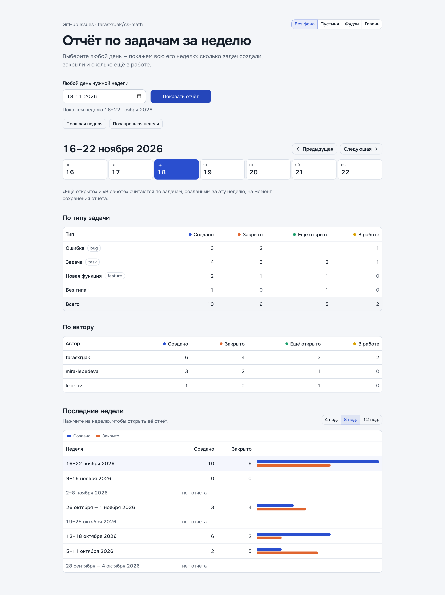
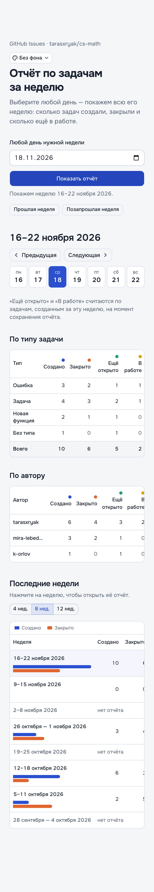

# Отчёт по задачам за неделю

Lab 8. Страница показывает недельную статистику GitHub Issues репозитория `tarasxryak/cs-math`. Пользователь выбирает понедельник, нажимает «Показать отчёт» и видит две таблицы: по типу задачи и по автору. В каждой таблице четыре счётчика: создано, закрыто, ещё открыто, в работе.

Данные сохраняет workflow Lab 7.2 в n8n Data Table `lab72_weekly_stats`. Lab 8 только читает их.

```
браузер ──GET /api/report?weekStart=2026-11-16──▶ Next.js route (сервер)
                                                    │  N8N_WEBHOOK_URL, N8N_WEBHOOK_TOKEN
                                                    ▼
                                      n8n «Read weekly report» ──▶ Data Table lab72_weekly_stats
```

| | |
|---|---|
| Стек | Next.js 16 (App Router), TypeScript, Tailwind CSS 4 |
| Библиотека компонентов | **shadcn/ui** (стиль base-nova на Base UI): `Button`, `Input`, `Field`, `Table`, `Alert`, `Empty`, `Skeleton`, `Spinner`, `Badge` |
| Тесты | Playwright: 22 теста, Chromium, десктоп и Pixel 7 |
| Прототип | [`prototype/index.html`](prototype/index.html), скриншоты в [`prototype/screenshots`](prototype/screenshots) |
| Workflow n8n | [`n8n/read-weekly-report.json`](n8n/read-weekly-report.json) |
| Использование ИИ | [`docs/ai-log.md`](docs/ai-log.md) |

## Запуск

Нужен Node.js 22 или новее.

```bash
npm install
cp .env.example .env.local   # впишите N8N_WEBHOOK_URL (и токен, если включён)
npm run dev                  # http://localhost:3000
```

Без `.env.local` страница откроется, но запрос отчёта вернёт ошибку «Сервис отчётов не настроен». Так тоже можно проверить состояние ошибки.

## Тесты

```bash
npx playwright install chromium   # один раз
npm run build                     # тесты работают с production-сборкой
npm test
```

Playwright сам поднимает `next start` на порту 3210 и заглушку n8n ([`tests/mock-n8n.mjs`](tests/mock-n8n.mjs)) на порту 3211. HTML-отчёт: `npx playwright show-report`. Те же шаги выполняет GitHub Actions ([`.github/workflows/test.yml`](.github/workflows/test.yml)).

Как тесты подменяют сервер:

- [`tests/report-form.spec.ts`](tests/report-form.spec.ts) перехватывает `GET /api/report` через `page.route` и отвечает фикстурами из [`tests/fixtures`](tests/fixtures). Формат совпадает с ответом workflow: `{ report }` или `{ report: null }`. Для теста загрузки ответ задерживается, пока тест его не отпустит.
- [`tests/e2e.spec.ts`](tests/e2e.spec.ts) ничего не перехватывает: браузер вызывает настоящий маршрут, а маршрут — заглушку n8n.
- [`tests/api.spec.ts`](tests/api.spec.ts) проверяет контракт маршрута. Заглушка требует `Bearer test-token`, поэтому каждый ответ 200 заодно подтверждает, что токен передаётся.

| Тест | Действие пользователя | Что видно на экране |
|---|---|---|
| показывает подписанное поле даты и кнопку | открывает страницу | поле «Понедельник недели» с подсказкой, кнопка «Показать отчёт» |
| Tab ведёт к полю и кнопке, фокус виден | нажимает Tab | фокус на поле, затем на кнопке, кольцо фокуса видно |
| дату можно ввести с клавиатуры и отправить Enter | печатает дату цифрами (16 11 2026), жмёт Enter | заголовок «16–22 ноября 2026», ровно один запрос |
| пустая дата | жмёт кнопку без даты | «Выберите понедельник недели», поле `aria-invalid`, фокус в поле, запроса нет |
| не понедельник | вводит 17.11.2026 | «17 ноября 2026 — вторник. Выберите понедельник, например 16 ноября.», запроса нет |
| неполная дата | вводит только день и месяц | «Дата введена не полностью. Формат: ДД.ММ.ГГГГ» |
| ошибка исчезает, когда дату исправили | исправляет дату и отправляет | ошибка пропала, таблицы появились |
| загрузка видна, повторная отправка не создаёт второй запрос | жмёт кнопку, пока ответ задержан, потом кликает, дважды кликает, жмёт Enter, вызывает `requestSubmit()` | «Загружаем отчёт…», кнопка недоступна, скелетон; **запрос ровно один** |
| отчёта нет | неделя без строки в таблице | «За эту неделю отчёта нет», таблиц нет |
| отчёт с нулями | неделя с нулевыми счётчиками | обе таблицы, «Всего 0 0 0 0», «За неделю задач не было» |
| ошибка сервера и повтор | первый ответ 502, затем «Повторить» | сообщение об ошибке, дата сохранена; после повтора таблицы на месте |
| нет сети | соединение оборвано, повтор клавишей Enter | «Нет связи с сервером.», после повтора отчёт |
| ссылка с ?week= | открывает `/?week=2026-11-16` | дата подставлена, отчёт загружен; новая отправка меняет URL |
| ответ в неверном формате | маршрут отдал неполный отчёт | понятная ошибка вместо сломанной таблицы |
| основной сценарий (e2e, десктоп и мобильный) | вводит дату, жмёт кнопку | все числа в обеих таблицах совпадают с данными n8n, страница не скроллится вбок |
| e2e: неделя без отчёта / сбой n8n | — | пустое состояние / ошибка с кнопкой «Повторить» |
| API: 4 теста | — | 200 с отчётом, 200 с `null`, 400 для не-понедельника, 502 при сбое или неверном ответе n8n |

Тесты проверены на поломку: если убрать защиту от повторной отправки, тест загрузки падает (2 запроса вместо 1). Если убрать текст ошибки, падают четыре теста ошибок. Подробности — в [`docs/ai-log.md`](docs/ai-log.md).

## Как устроена форма

- **Поле даты.** Это shadcn `Input type="date"` внутри `Field`, с подписью `FieldLabel`. Нативное поле работает с клавиатуры (Tab, стрелки, цифры) и открывает системный календарь на телефоне. Поэтому выбран не `Calendar` в поповере.
- **Проверка.** Пустое значение, неполная дата (`validity.badInput`), несуществующая дата и не понедельник. Ошибка выводится под полем через `FieldError` и связана с полем через `aria-describedby`. Фокус возвращается в поле.
- **Без двойной отправки.** Пока идёт запрос, кнопка недоступна (`aria-disabled`, фокус остаётся на ней). Но Enter в поле всё равно отправляет форму. Поэтому `handleSubmit` сначала проверяет `pendingRef`. Ref меняется синхронно и отсекает повторы в том же тике, когда `useState` ещё не успел обновиться ([`src/components/report-viewer.tsx`](src/components/report-viewer.tsx)).
- **Ошибка.** Выбранная дата остаётся. «Повторить» заново отправляет форму с той же проверкой и той же защитой.
- **Состояния.** Скелетон во время загрузки, `Empty` при `report: null`, таблицы для отчёта даже с нулями, `Alert` при ошибке. Скрытый `role="status"` озвучивает загрузку и результат.
- **Ссылка.** Неделя записывается в `?week=`. Ссылку можно отправить, отчёт откроется сразу.

## Тема

Цвета, шрифт и радиусы заданы в одном месте — [`src/app/globals.css`](src/app/globals.css). Это переменные shadcn (`--background`, `--primary`, `--muted-foreground` и т. д.) и четыре цвета метрик (`--metric-opened`, `--metric-closed`, `--metric-open`, `--metric-progress`) по мотивам цветов статусов Issues в GitHub. Шрифт Onest (латиница и кириллица) подключён через `next/font` в [`src/app/layout.tsx`](src/app/layout.tsx). Контраст текста к фону — не ниже 4.5:1. Отступы — шкала Tailwind.

## n8n: workflow «Read weekly report»

1. В n8n: **Workflows → Import from File** → [`n8n/read-weekly-report.json`](n8n/read-weekly-report.json).
2. Цепочка: `Webhook (GET /webhook/lab8-weekly-report)` → `Validate weekStart` → `Is a Monday?` → `Open weekly stats table` → `Find saved week` (Data Table, `repository = tarasxryak/cs-math`, `week_start = weekStart`, limit 1) → `Build report` → `Respond with report`.
3. `Find saved week` включает **Always Output Data**. Если строки нет, дальше идёт пустой item, `Build report` отвечает `{ "report": null }`, и webhook не зависает.
4. Неверный `weekStart` получает 400 через `Respond 400`.
5. **Publish / Activate** workflow и скопируйте **Production URL** из узла Webhook.
6. Необязательно: Webhook → Authentication → **Header Auth**. Credential с именем `Authorization` и значением `Bearer <токен>`. Тот же токен положите в `N8N_WEBHOOK_TOKEN`.

Проверка из терминала:

```bash
curl "https://<ваш-n8n>/webhook/lab8-weekly-report?weekStart=2026-11-16"
# { "report": { "repository": "tarasxryak/cs-math", "weekStart": "2026-11-16", "totals": {...}, "byType": {...}, "byAuthor": [...] } }
```

## Vercel

1. **Add New → Project** → импорт репозитория `tarasxryak/vibecode-front`. Framework определится как Next.js, настройки сборки по умолчанию.
2. **Settings → Environment Variables** для Production (и Preview, если нужно):
   - `N8N_WEBHOOK_URL` — Production URL webhook;
   - `N8N_WEBHOOK_TOKEN` — только если включён Header Auth.

   Префикс `NEXT_PUBLIC_` не нужен: переменные читает только серверный маршрут [`src/app/api/report/route.ts`](src/app/api/report/route.ts).
3. **Deploy**. После изменения переменных нужен **Redeploy**.

## Структура

```
src/app/page.tsx                страница
src/app/api/report/route.ts     серверный маршрут → n8n
src/components/report-viewer.tsx  форма, состояния, защита от повторной отправки
src/components/report-tables.tsx  полоса недели и две таблицы
src/components/ui/              компоненты shadcn/ui
src/lib/report.ts               типы и проверка ответа n8n
src/lib/week.ts                 даты: понедельник, диапазон недели, форматы ru-RU
n8n/read-weekly-report.json     workflow для импорта
prototype/                      прототип (HTML) и его скриншоты
docs/screenshots/               скриншоты готового интерфейса во всех состояниях
tests/                          Playwright, фикстуры, заглушка n8n
scripts/capture-screenshots.mjs пересъёмка скриншотов
```

## Скриншоты

| | Десктоп | Телефон |
|---|---|---|
| Отчёт |  |  |
| Загрузка |  |  |
| Пусто |  |  |
| Ошибка сервера |  |  |
| Ошибка ввода |  |  |
