# Отчёт по задачам за неделю

Lab 8. Страница показывает недельную статистику GitHub Issues репозитория `tarasxryak/cs-math`.

- **Отчёт за неделю.** Выберите любой день, и страница покажет всю его неделю (пн–вс, МСК): две таблицы, по типу задачи и по автору. В каждой таблице четыре счётчика: создано, закрыто, ещё открыто, в работе.
- **Переходы.** Кнопки «Прошлая неделя» и «Позапрошлая неделя», стрелки к соседним неделям. Неделя попадает в ссылку `?week=`.
- **Последние недели.** Список из 4, 8 или 12 последних завершённых недель: сколько задач создали и закрыли, с полосками для сравнения. Клик по неделе открывает её отчёт.

Данные сохраняет workflow Lab 7.2 в n8n Data Table `lab72_weekly_stats`. Lab 8 только читает их.

```
браузер ──GET /api/report?weekStart=…───────▶ Next.js (сервер) ──▶ n8n /webhook/lab8-weekly-report  ─┐
        ──GET /api/history?until=…&weeks=8──▶                  ──▶ n8n /webhook/lab8-weekly-history ─┴▶ Data Table lab72_weekly_stats
```

| | |
|---|---|
| Живая версия | https://vibecode-front.vercel.app |
| Стек | Next.js 16 (App Router), TypeScript, Tailwind CSS 4 |
| Библиотека компонентов | **shadcn/ui** (стиль base-nova на Base UI): `Button`, `Input`, `Field`, `Table`, `ToggleGroup`, `Alert`, `Empty`, `Skeleton`, `Spinner`, `Badge` |
| Тесты | Playwright: 35 тестов, Chromium, десктоп и Pixel 7 |
| Прототип | [`prototype/index.html`](prototype/index.html), скриншоты в [`prototype/screenshots`](prototype/screenshots) |
| Workflow n8n | [`n8n/read-weekly-report.json`](n8n/read-weekly-report.json) |
| Использование ИИ | [`docs/ai-log.md`](docs/ai-log.md) |

## Запуск

Нужен Node.js 22 или новее.

```bash
npm install
cp .env.example .env.local   # впишите N8N_WEBHOOK_URL (и токен, если включён)
npm run dev                  # http://localhost:3000
```

Без `.env.local` страница откроется, но запросы вернут ошибку «Сервис отчётов не настроен.». Так тоже можно проверить состояние ошибки.

## Тесты

```bash
npx playwright install chromium   # один раз
npm run build                     # тесты работают с production-сборкой
npm test
```

Playwright сам поднимает `next start` на порту 3210 и заглушку n8n ([`tests/mock-n8n.mjs`](tests/mock-n8n.mjs)) на порту 3211. HTML-отчёт: `npx playwright show-report`. Те же шаги выполняет GitHub Actions ([`.github/workflows/test.yml`](.github/workflows/test.yml)).

Часы браузера в тестах заморожены на среде, 25 ноября 2026, 12:00 МСК. Текущая неделя — 23–29 ноября, последняя завершённая — 16–22 ноября. Поэтому результаты не зависят от дня запуска.

Как тесты подменяют сервер:

- [`tests/report-form.spec.ts`](tests/report-form.spec.ts) и [`tests/trend.spec.ts`](tests/trend.spec.ts) перехватывают `GET /api/report` и `GET /api/history` через `page.route` и отвечают фикстурами в формате настоящих ответов. Для тестов загрузки ответ задерживается, пока тест его не отпустит.
- [`tests/e2e.spec.ts`](tests/e2e.spec.ts) ничего не перехватывает: браузер вызывает настоящие маршруты, а маршруты — заглушку n8n.
- [`tests/api.spec.ts`](tests/api.spec.ts) проверяет контракт маршрутов. Заглушка требует `Bearer test-token`, поэтому каждый ответ 200 заодно подтверждает, что токен передаётся.

| Тест | Действие пользователя | Что видно на экране |
|---|---|---|
| поле с подписью, подсказка, быстрый выбор | открывает страницу | поле «Любой день нужной недели», подсказка, кнопки «Прошлая неделя» и «Позапрошлая неделя» |
| Tab ведёт к полю и кнопке | нажимает Tab | фокус на поле, затем на кнопке, кольцо фокуса видно |
| любой день недели | печатает 18.11.2026 цифрами, жмёт Enter | подсказка «Покажем неделю 16–22 ноября 2026.», запрос за понедельник 16.11, ссылка `?week=2026-11-16` |
| пустая дата | жмёт кнопку без даты | «Выберите дату.», поле `aria-invalid`, фокус в поле, запроса нет |
| неполная дата | вводит только день и месяц | «Дата введена не полностью. Формат: ДД.ММ.ГГГГ.» |
| будущая дата | выбирает 02.12.2026 | «Эта дата ещё не наступила…», запроса нет |
| ошибка исчезает, когда дату исправили | исправляет дату и отправляет | ошибка пропала, таблицы появились |
| загрузка и повторная отправка | пока ответ задержан: клик, двойной клик, Enter, `requestSubmit()`, «Прошлая неделя» | «Загружаем…», кнопка недоступна, скелетон; **запрос ровно один** |
| кнопка не меняет ширину | отправляет форму | ширина кнопки до и во время загрузки совпадает |
| прошедшая неделя без отчёта | выбирает 04.11.2026 | заголовок «2–8 ноября 2026», «За эту неделю отчёта нет» |
| текущая неделя | выбирает 24.11.2026 | «Неделя ещё идёт», когда появится отчёт; кнопка «Открыть прошлую неделю» работает |
| отчёт с нулями | неделя с нулевыми счётчиками | обе таблицы, «Всего 0 0 0 0», «За неделю задач не было» |
| ошибка сервера и повтор | ответ 502 без точки в конце, затем «Повторить» | два отдельных предложения: «Сервис отчётов не ответил.» и «Дата сохранена — можно повторить запрос.»; после повтора таблицы |
| нет сети | соединение оборвано, повтор клавишей Enter | «Нет связи с сервером.», после повтора отчёт |
| ответ в неверном формате | маршрут отдал неполный отчёт | понятная ошибка вместо сломанной таблицы |
| быстрый выбор | «Прошлая неделя», затем «Позапрошлая неделя» | отчёты за 16–22 и 9–15 ноября |
| стрелки | «Следующая», затем «Предыдущая» | во время загрузки прежний отчёт виден приглушённым; текущая неделя — «Неделя ещё идёт»; дальше в будущее кнопка недоступна |
| ссылка с ?week= | открывает `/?week=2026-11-19` | отчёт за 16–22 ноября; новая отправка меняет ссылку |
| последние недели | открывает страницу | 8 недель, новые сверху; недели без отчёта помечены «нет отчёта»; есть легенда |
| переключатель недель | жмёт «4 нед.» | пока идёт запрос, прежний список виден; потом 4 строки |
| клик по неделе в списке | жмёт «16–22 ноября 2026» | открывается отчёт, строка отмечена как текущая |
| неделя без отчёта в списке | — | её нельзя нажать |
| ошибка списка недель | ответ 502, затем «Повторить» | сообщение и рабочий повтор |
| e2e: основной сценарий (десктоп и мобильный) | вводит 19.11.2026 | все числа в обеих таблицах совпадают с данными n8n, страница не скроллится вбок |
| e2e: последние недели (десктоп и мобильный) | клик по неделе | список из заглушки n8n, пропуски отмечены, отчёт открывается |
| e2e: неделя без отчёта / сбой n8n | — | пустое состояние / ошибка с кнопкой «Повторить» |
| API: 6 тестов | — | отчёт и `null`; 400 для неверных дат; 502 с законченным предложением; календарь недель с пропусками; 400 для неверных `until` и `weeks` |

Тесты проверены на поломку: если убрать защиту от повторной отправки, тест загрузки падает (2 запроса вместо 1). Если убрать текст ошибки, падают тесты ошибок. Подробности — в [`docs/ai-log.md`](docs/ai-log.md).

## Как устроена форма

- **Поле даты.** Это shadcn `Input type="date"` внутри `Field`, с подписью `FieldLabel`. Подходит любой день: запрос уходит за понедельник его недели, а подсказка под полем сразу называет неделю. Клик в любом месте поля открывает календарь (`showPicker()`), будущие даты в нём недоступны (`max`). С клавиатуры работают Tab, стрелки и цифры.
- **Проверка.** Пустое значение, неполная дата (`validity.badInput`), несуществующая дата и будущая дата. Ошибка выводится под полем через `FieldError` и связана с полем через `aria-describedby`. Фокус возвращается в поле. Все сообщения — законченные предложения с точкой.
- **Без двойной отправки.** Пока идёт запрос, кнопки недоступны (`aria-disabled`, фокус остаётся на месте). Но Enter в поле всё равно отправляет форму. Поэтому каждая загрузка сначала проверяет `pendingRef`. Ref меняется синхронно и отсекает повторы в том же тике, когда `useState` ещё не успел обновиться ([`src/components/report-viewer.tsx`](src/components/report-viewer.tsx)). У кнопки фиксированная ширина, поэтому «Загружаем…» её не сдвигает.
- **Состояния.**
  - Скелетон показывается только при первой загрузке. При переходе между неделями прежний отчёт остаётся на экране приглушённым — без прыжков разметки.
  - `Empty` разный для прошедшей недели без отчёта и для текущей недели. У текущей — дата, когда появится отчёт, и кнопка «Открыть прошлую неделю».
  - Таблицы показываются даже для отчёта с нулями.
  - `Alert` при ошибке: сообщение сервера и подсказка про повтор идут отдельными предложениями.
  - Скрытый `role="status"` озвучивает загрузку и результат.
- **Последние недели** ([`src/components/week-trend.tsx`](src/components/week-trend.tsx)).
  - Это таблица, которая заодно работает как график: числа идут текстом, полоски помогают сравнивать недели на глаз.
  - Два ряда — «Создано» и «Закрыто» — с легендой. Цвета проверены скриптом скилла `dataviz` на различимость, в том числе при дальтонизме.
  - На телефоне полоски уходят под название недели.

## Тема

Цвета, шрифт и радиусы заданы в одном месте — [`src/app/globals.css`](src/app/globals.css).

- **Переменные shadcn:** `--background`, `--primary`, `--muted-foreground` и т. д.
- **Цвета метрик:** `--metric-opened` (синий), `--metric-closed` (оранжевый), `--metric-open` (зелёный), `--metric-progress` (янтарный).
- **Шрифт:** Onest (латиница и кириллица), подключён через `next/font` в [`src/app/layout.tsx`](src/app/layout.tsx).
- **Контраст и отступы:** контраст текста к фону — не ниже 4.5:1, отступы — шкала Tailwind.

## n8n: workflow «Read weekly report»

1. В n8n: **Workflows → Import from File** → [`n8n/read-weekly-report.json`](n8n/read-weekly-report.json).
2. В workflow две независимые ветки:
   - `GET /webhook/lab8-weekly-report?weekStart=YYYY-MM-DD`: проверка понедельника → строка из Data Table (`repository = tarasxryak/cs-math`, `week_start = weekStart`) → `{ report }` или `{ report: null }`. Неверный `weekStart` получает 400.
   - `GET /webhook/lab8-weekly-history`: все сохранённые недели репозитория → `{ reports: [{ weekStart, totals }] }`, новые сверху. Строка с повреждённым `stats_json` пропускается и не роняет ответ.
3. Узлы чтения таблицы включают **Always Output Data**. Если строк нет, дальше идёт пустой item, и webhook всё равно отвечает.
4. **Publish / Activate** workflow. Адрес истории приложение строит само: заменяет последний сегмент `N8N_WEBHOOK_URL` на `lab8-weekly-history`. Если путь другой, задайте `N8N_HISTORY_WEBHOOK_URL`.
5. Необязательно: в обоих узлах Webhook → Authentication → **Header Auth**. Credential с именем `Authorization` и значением `Bearer <токен>`. Тот же токен положите в `N8N_WEBHOOK_TOKEN`.

Проверка из терминала:

```bash
curl "https://<ваш-n8n>/webhook/lab8-weekly-report?weekStart=2026-11-16"
curl "https://<ваш-n8n>/webhook/lab8-weekly-history"
```

## Vercel

1. **Add New → Project** → импорт репозитория `tarasxryak/vibecode-front`. Framework определится как Next.js, настройки сборки по умолчанию.
2. **Settings → Environment Variables** для Production (и Preview, если нужно):
   - `N8N_WEBHOOK_URL` — Production URL webhook отчёта;
   - `N8N_WEBHOOK_TOKEN` — только если включён Header Auth;
   - `N8N_HISTORY_WEBHOOK_URL` — только если путь истории не `lab8-weekly-history`.

   Префикс `NEXT_PUBLIC_` не нужен: переменные читает только сервер ([`src/lib/n8n.ts`](src/lib/n8n.ts) помечен `server-only`).
3. **Deploy**. После изменения переменных нужен новый деплой: Redeploy в Vercel или любой push в `main`.

## Структура

```
src/app/page.tsx                  страница
src/app/api/report/route.ts       отчёт за неделю → n8n
src/app/api/history/route.ts      последние недели → n8n, пропуски заполняются null
src/lib/n8n.ts                    вызов webhook, таймаут, токен, тексты ошибок
src/components/report-viewer.tsx  форма, переходы между неделями, состояния, защита от повторной отправки
src/components/report-tables.tsx  полоса недели и две таблицы
src/components/week-trend.tsx     последние недели
src/components/ui/                компоненты shadcn/ui
src/lib/report.ts                 типы и проверка ответов n8n
src/lib/week.ts                   даты: неделя любого дня, сдвиг на недели, «сегодня» по Москве
n8n/read-weekly-report.json       workflow для импорта
prototype/                        прототип (HTML) и его скриншоты
docs/screenshots/                 скриншоты готового интерфейса во всех состояниях
tests/                            Playwright, фикстуры, заглушка n8n
scripts/capture-screenshots.mjs   пересъёмка скриншотов
```

## Скриншоты

Сняты с замороженными часами (25 ноября 2026) и тестовыми данными. [Скриншот с настоящими данными из n8n](docs/screenshots/live-desktop-2026-11-16.png).

| | Десктоп | Телефон |
|---|---|---|
| Отчёт и последние недели |  |  |
| Страница открыта | 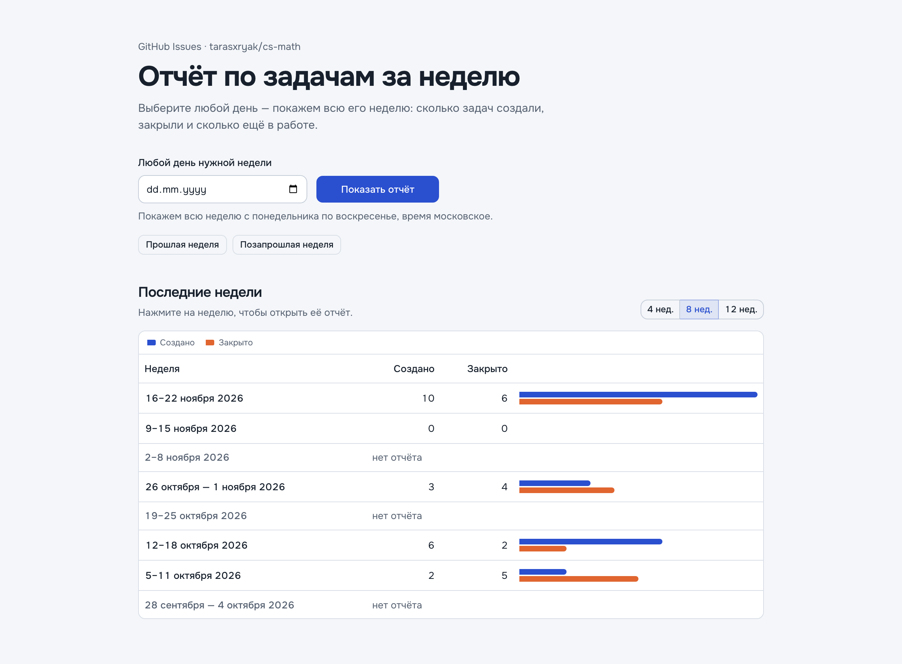 | 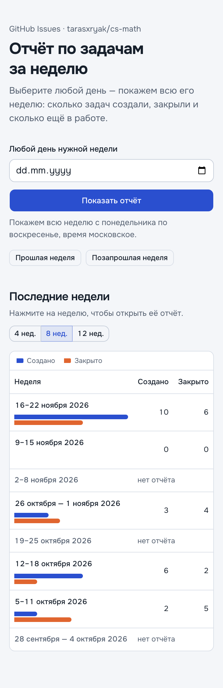 |
| Загрузка | 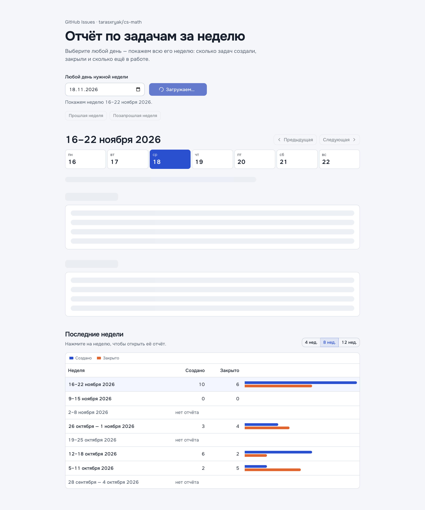 | 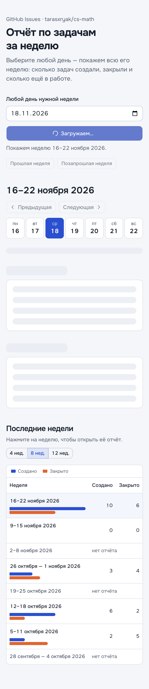 |
| Нет отчёта | 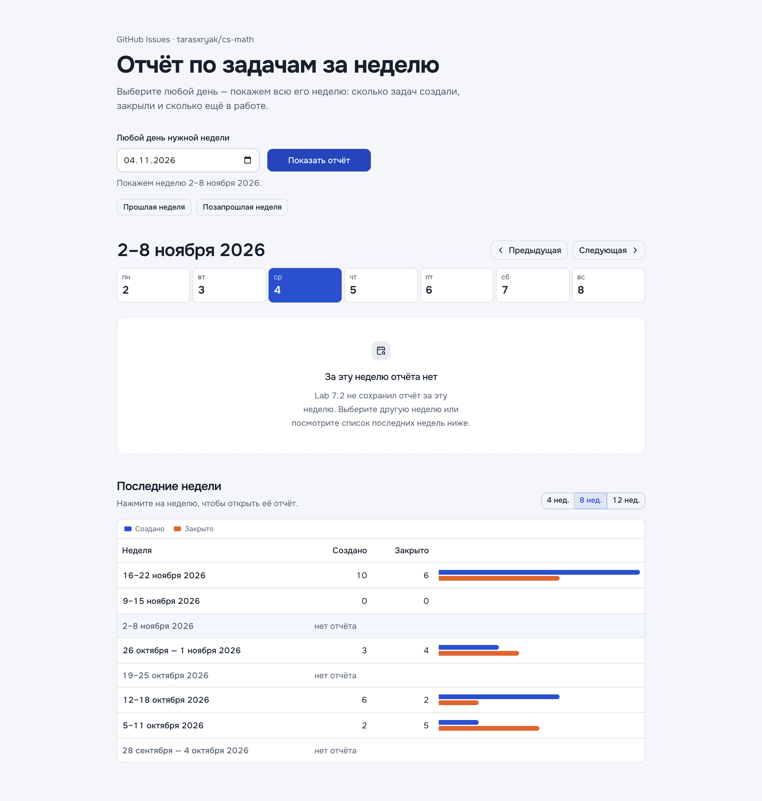 | 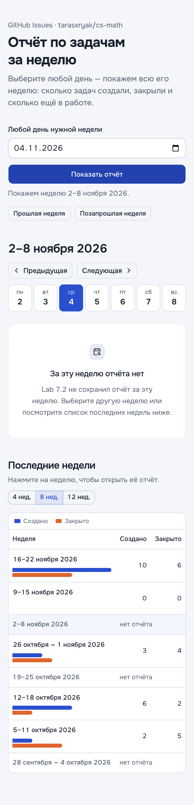 |
| Неделя ещё идёт | 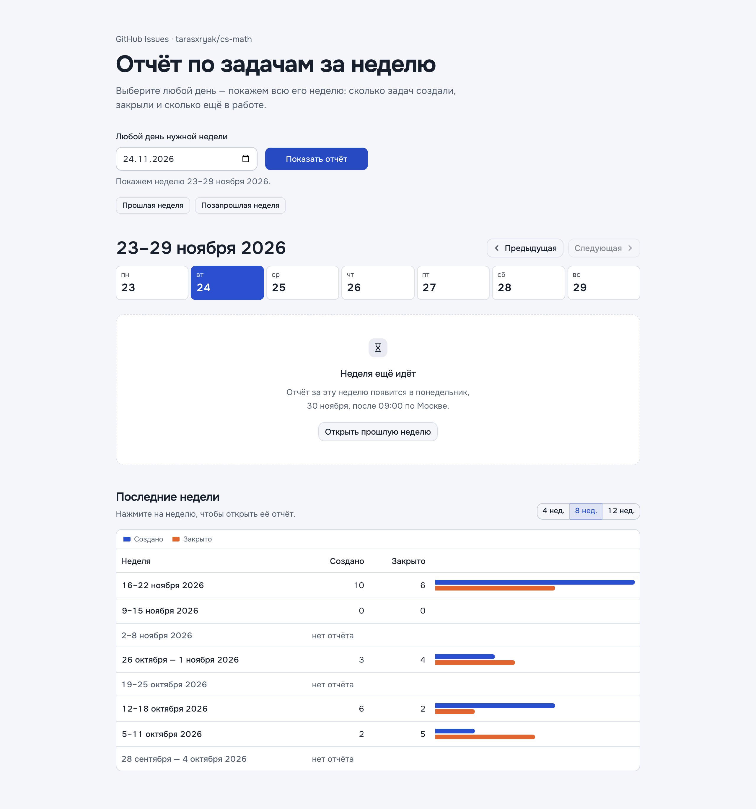 | 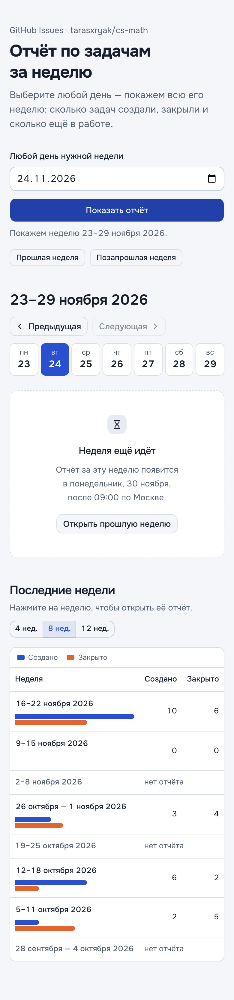 |
| Ошибка сервера | 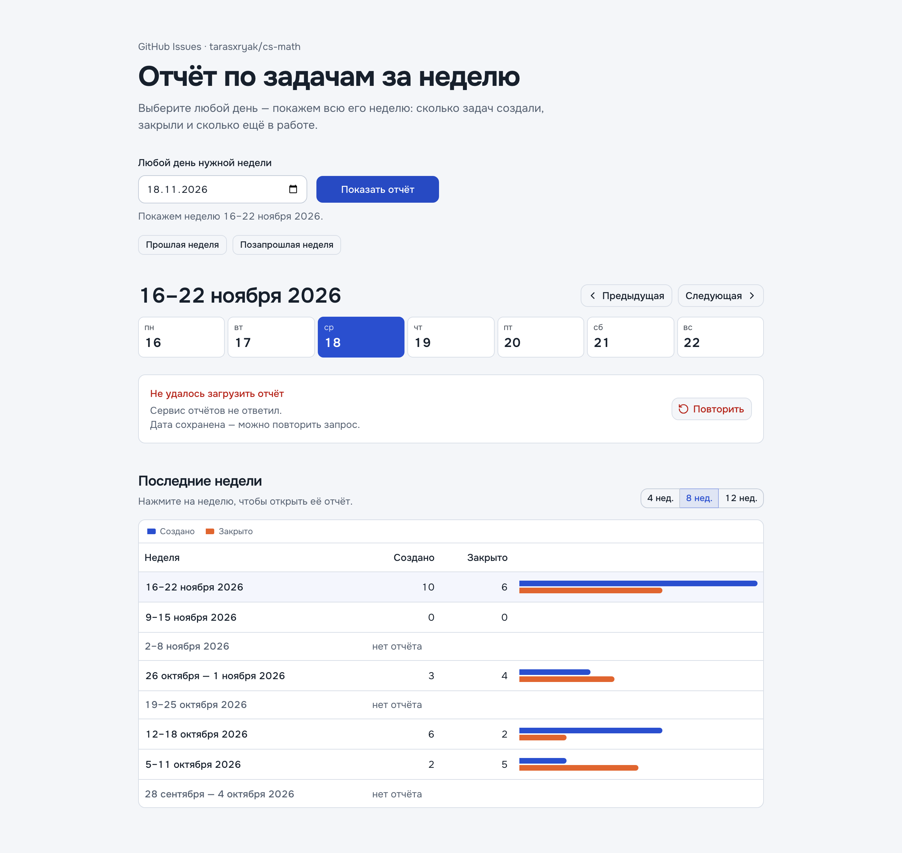 | 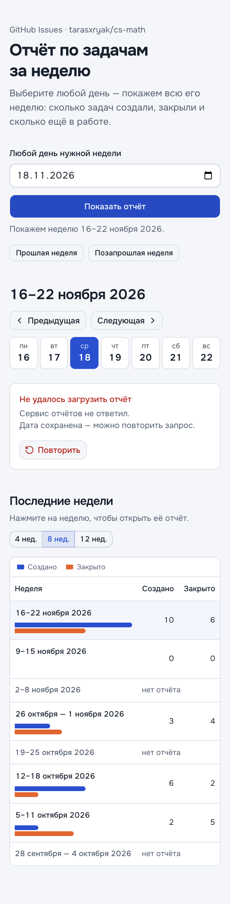 |
| Ошибка ввода | 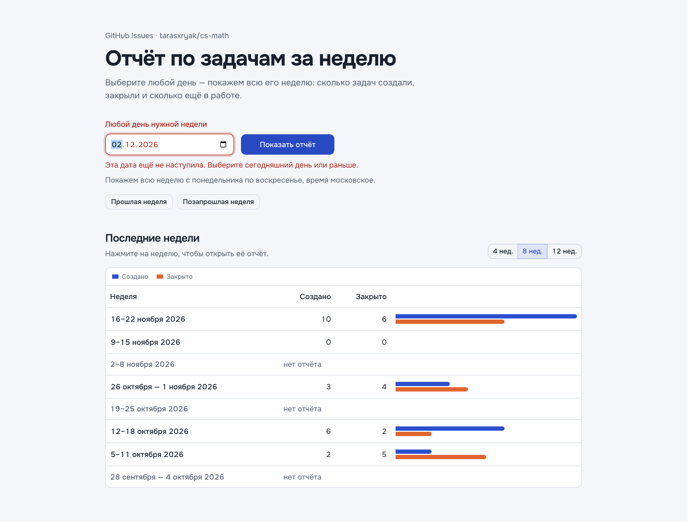 | 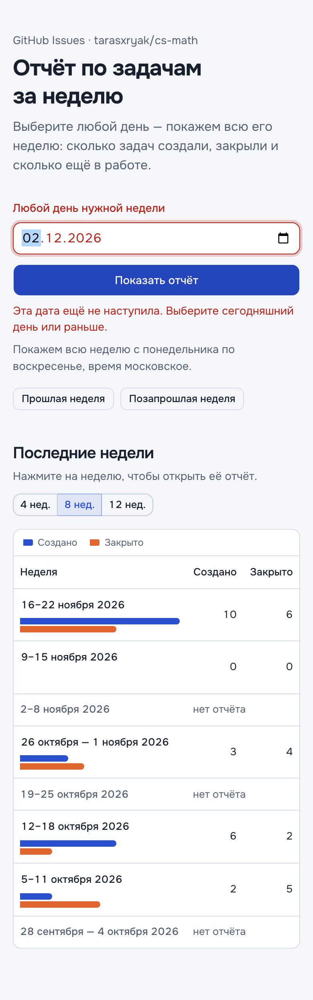 |
